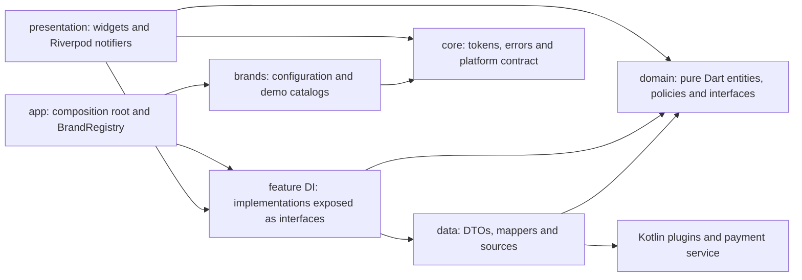

# Secure Payment Portal

[](https://github.com/MaximLisovy/secure_payment_portal/actions/workflows/ci.yml)

A multi-tenant payment confirmation module built from one Flutter codebase, with two independently installable Android
apps. It combines configurable branding, native security checks, a foreground payment simulation and an isolated scan
animation. There is no backend: payment APIs are simulated behind interfaces a real backend could implement.

## Quickstart

Install Flutter 3.41.x, Android SDK 36 and JDK 21, then:

```bash
git clone https://github.com/MaximLisovy/secure_payment_portal.git
cd secure_payment_portal
flutter pub get
flutter run --flavor retail
# Stop the first run before starting the other flavor:
flutter run --flavor utility
```

`--flavor` is required; there is no flavor-less APK. CI pins Flutter 3.41.9; the project uses Dart 3.11.5. Configure Flutter
with `flutter config --jdk-dir="<path to JDK 21>"` and check `flutter doctor -v`. Raw Gradle commands need `JAVA_HOME`
separately. Java bytecode targets 17, but builds were verified with JDK 21; JDK 25 fails with the current Kotlin plugin.
The packaging script also needs `jq`; ImageMagick is needed only to regenerate launcher icons.

To try the app without building, download your brand's APK from the
[v1.0.0 GitHub Release](https://github.com/MaximLisovy/secure_payment_portal/releases/tag/v1.0.0).
Installation and signing notes are [below](#release-and-install). Full setup details are in
[Manual QA](docs/MANUAL_QA.md#run-it).

## What the app does

The payment page loads a bill, checks device security, enables Pay when permitted, and shows native processing progress
followed by a receipt, failure or cancellation. Confirmation performs a fresh security read. Every execution has a new
attempt ID, so a delayed event or cancellation from an earlier execution cannot complete or cancel a retry.

An uncertain start enters “checking payment status”: it queries an attempt-scoped native snapshot immediately, retries
with capped backoff for 30 seconds and continues accepting stream events. Expiry retains the attempt and Cancel while
withholding payment retry; an idle snapshot does not prove rejection. Confirmed start refusals permit retry. If the progress
stream never supplies its first event, a five-second deadline shows an unavailable state with Check again.
The [channel contract](docs/platform_channels.md#uncertain-payment-outcomes-and-reconciliation) contains the classification table.

Debug and profile builds include an app-bar brand switcher and a demo panel. Each platform source can use real readings or
simulated root, recording and processing scenarios; the bill backend can simulate being offline. A SIMULATED badge appears
whenever a source is simulated, including in release. Window protection always uses the real platform source. The panel
also offers a performance overlay, rolling build/raster statistics and Reset. Reported display Hz is distinct from measured
FPS. See the [demo guide](docs/DEMO_SCRIPT.md#demo-scenarios-debug-and-profile-builds) for scenarios and recording instructions.

## Brands and adding a third

| | Retail Shop (`retail`) | Utility Pay (`utility`) |
|---|---|---|
| Appearance | orange/gold, rounded, fluid | navy/slate, sharp, dense |
| Payment sections | summary and Promo Banner | summary and Bill Breakdown |
| Scan period | 2.4 seconds, soft pulses | 1.6 seconds, quick pulses |


Visual differences live in four small `ThemeExtension` token families: colors, shape, density and motion. One `ThemeFactory`
builds themes; real `lerp` implementations animate switching. Structural differences are ordered section specifications
rendered through a registry. Features never import a brand or branch on its identity. Only `BrandRegistry` reads `appFlavor`.

To add a third brand:

1. Create `lib/brands/<id>/<id>_brand.dart` with a const `BrandConfig` and `BrandRegistration`. Declare its `DemoBill` data,
   include it in `demoBills`, and select its bill through `demoPaymentId`.
2. Import the registration in `lib/app/brand/brand_registry.dart` and add
   `if (!kReleaseMode || appFlavor == '<id>') <id>Registration` to the const list.
3. Add its ID, display name and application-ID suffix to `android/brands.json`; Gradle generates the flavor.
4. Add launcher resources under `android/app/src/<id>/res/`, set colors and glyph, and regenerate legacy icon PNGs with
   `python3 tool/make_launcher_icons.py`.
5. Run the checks and inspect release isolation with `tool/check_release_brand_isolation.py`.

Debug/profile keep all registrations; release keeps its own brand and demo catalog. All-brands, contrast, icon and manifest
tests discover registrations automatically. A scratch third brand passed those tests and built without feature or core
edits. The [brand guide](docs/ai/appendix/scaling-path.md#multi-tenancy) preserves the detailed recipe and scaling options.

## Architecture



The dependency rule is `presentation → domain ← data`. Domain contains no Flutter, channels or JSON. DI wires data
implementations and exposes domain interfaces; data maps exceptions to typed failures. Riverpod 3 uses one notifier per
flow, no code generation, no side effects in `build()`, mounted checks after awaits and root retry disabled.

Errors are values: sealed `Result<T>` contains `Success` or `Err(Failure)`, with exhaustive failure families per feature.
Money uses integer minor units. Unknown security facts stay tri-state. Architecture source checks enforce common import and
branding violations as guardrails; they do not prove architecture. The
[architecture reference](docs/ai/appendix/scaling-path.md#architecture) includes the full flow and bridge diagrams.

The scan uses elapsed-time mathematics, a `CustomPainter(repaint: animation)` and separate repaint boundaries for its
moving and static layers. It allocates no objects in `paint()` and rebuilds no widgets per frame. Reduced motion displays a
still pose. The verdict waits until a revolution ends, adding 1.6–2.4 seconds on fast checks; reduced motion and the final
confirmation check bypass that hold. This timing was unchanged by the reviews.
[Performance evidence](docs/ai/appendix/performance.md) records formulas, isolation tests, benchmarks and their limits.

## Native Android features

`MainActivity` wires small Kotlin plugins; lifecycle-scoped coroutines and testable ports own the work. `SafeResult`
provides at-most-one reply on the main thread. Engine detach can abandon a call before a reply, so Dart also applies
command deadlines. Channel names, payloads and errors are mirrored and tested across languages.

- **Root heuristics:** six concurrent probes check binaries, artifacts, packages, `which su`, test keys and build type.
  A clean verdict needs all strong checks conclusive; weak-only signals are allowed with that confidence. Unknown blocks.
  Awaiting probes has a deadline even when an OS call remains blocked.
- **Recording visibility:** API 35+ reports whether this app is visible in a recording. Unknown recording state below API
  35 is allowed; positive visibility blocks confirmation. This cannot detect every active recorder.
- **Secure window:** sensitive content appears only after `FLAG_SECURE` is confirmed. Pending protection shows a neutral
  placeholder; failure blocks with a protection recheck. Reference counting and Activity recreation preserve protection
  through navigation. Screenshots, recordings and Recents captures are protected.
- **Payment service:** a `shortService` runs 20 simulated 400 ms steps with generic, lock-screen-private progress updates
  throttled to twice per second. A non-exported broadcast receiver handles notification Cancel. Atomic attempt-scoped store
  transitions decide cancellation versus completion. The service is `START_NOT_STICKY`, handles timeout and releases claims
  on refused starts. Denied notification permission does not prevent payment.

Minimum Android API is 24. Notification channels require 26, runtime notification permission 33, `shortService` rules 34,
and recording visibility 35. Guards provide compatibility below those levels. The
[native reference](docs/platform_channels.md#native-android-features) covers APIs, policy and device findings.

## Testing and CI

```bash
dart format --set-exit-if-changed lib test integration_test test_driver
flutter analyze
flutter test
(cd android && JAVA_HOME="<path to JDK 21>" ./gradlew testDebugUnitTest)
flutter build apk --debug --flavor retail
flutter build apk --debug --flavor utility
```

Current validation includes 888 Dart tests and 226 Kotlin/JVM tests. Coverage spans domain policies, shared fake/channel
contract suites, repository mapping, notifier races, widgets, every brand, native stores and lifecycle handling, manifest
guards and documentation links. Targeted manual mutations found regression gaps that were fixed; no comprehensive mutation
score is claimed.

CI runs formatting, zero-issue analysis and both suites on pushes to `main` and pull requests, then builds a release APK
for each brand from `android/brands.json` and uploads artifacts. It pins Flutter 3.41.9, Temurin 21 and action commit SHAs.
Emulator payment-flow, engine-replacement and frame-timing suites run separately from CI. Their commands and coverage are
in [Manual QA](docs/MANUAL_QA.md#tests-and-ci); phone checks and untested items are recorded there too.

## Release and install

Run `tool/build_release_apks.sh` to package both release APKs and both arm64 profile APKs into `dist/`, with `SHA256SUMS`
and `SOURCE_REVISION` identifying the source HEAD. Individual Flutter builds write to `build/app/outputs/flutter-apk/`.
Release excludes demo tools; profile retains them for blocked-state, decline and failure demonstrations.

Download from the [GitHub Release](https://github.com/MaximLisovy/secure_payment_portal/releases/tag/v1.0.0), allow installation
from your browser or files app when Android asks, then open the APK. Retail and Utility install side by side with package
suffixes `.retail` and `.utility`. A signing-key mismatch requires uninstalling the older copy first.

Release APKs deliberately use debug signing so the repository needs no keystore or secrets. They are review builds; a CI
APK may not install over a locally built one with another debug key. Store distribution needs externally supplied signing
credentials. [Packaging and signing details](docs/MANUAL_QA.md#release-signing) remain documented.

## Known limitations

Payments and snapshots are in memory; process death loses an attempt. There is no durable intent store, server idempotency
or backend reconciliation. Native processing always succeeds; declines/failures are demo scenarios. A roughly three-minute
`shortService` limit suits this simulation. The [production appendix](docs/ai/appendix/payments-in-production.md) explains the missing pieces.

Root heuristics are bypassable and inaccessible paths can resemble absent artifacts. Recording visibility varies by API
and recorder: the phone's OEM recorder stayed silent while captures were black; the stock emulator recorder triggered
with `FLAG_SECURE` both on and off. The OEM explanation remains unproven. `FLAG_SECURE` is the primary capture control.

iOS compiles but has no native implementation; unavailable channels block payment. Themes are light-only; money and UTC
receipt dates use fixed formatting rather than locale-aware formatting. Frame timings were measured on a 60 Hz emulator;
the phone's observed 120 FPS was qualitative. The historical single-phone run predates these fixes, and permission prompts,
lock screen, swipe-away, battery saver and other Android versions remain untested. No new phone measurements are claimed.

## Documents and AI contribution

Claude Code implemented the initial milestones. Codex reviewed and implemented an earlier approved pass of 13 commits,
about 2,300 lines including attempt isolation. The developer reviewed plans and smaller diffs and verified the large change
through tests and device runs. Later independent-review fixes are linked in the review summary; significant decisions live
in commit messages.

- [AI Insight Report](docs/ai/AI_INSIGHT_REPORT.md) and [Prompt Log](docs/ai/PROMPT_LOG.md): a short report and three selected interactions.
- [Review summary](docs/ai/appendix/review.md): both reviews, corrections and commits.
- [Platform channels](docs/platform_channels.md), [Manual QA](docs/MANUAL_QA.md) and [demo script](docs/DEMO_SCRIPT.md): implementation and verification references.
- [AGENTS.md](AGENTS.md) and [topic rules](.agents/rules): repository working conventions.
