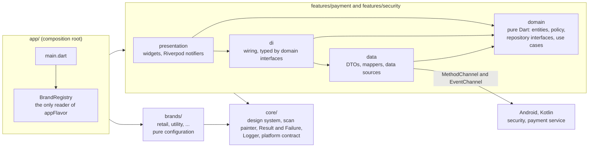
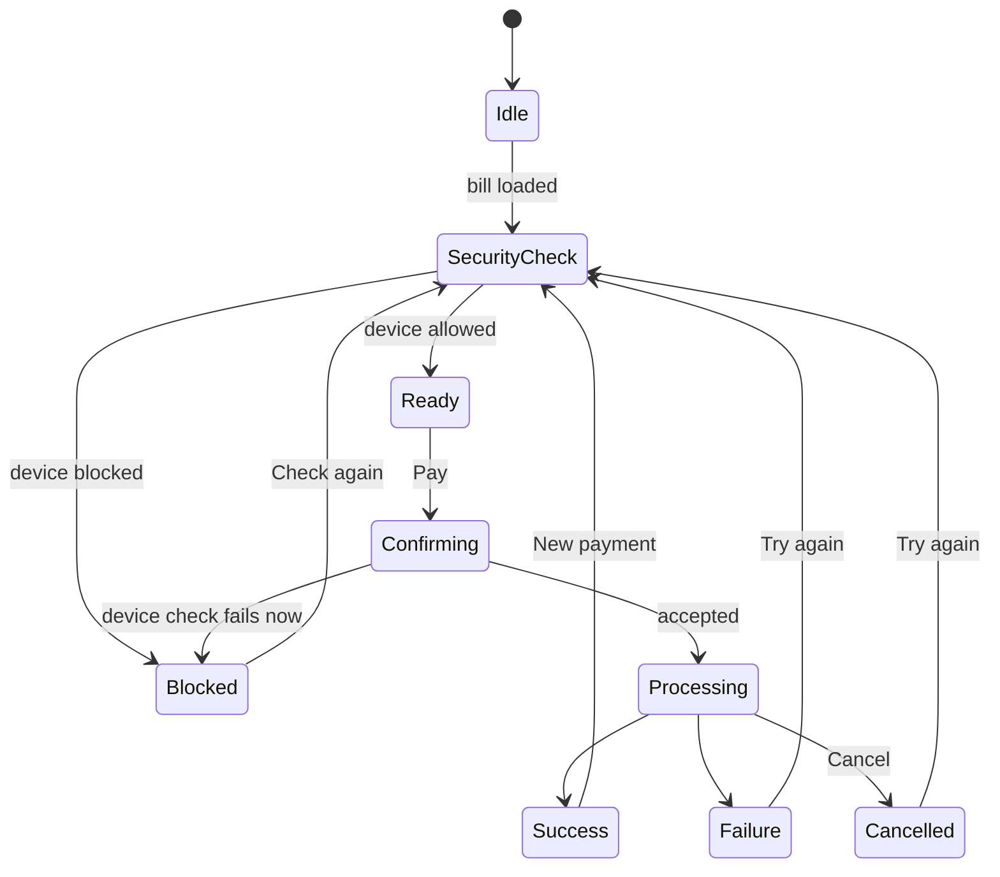
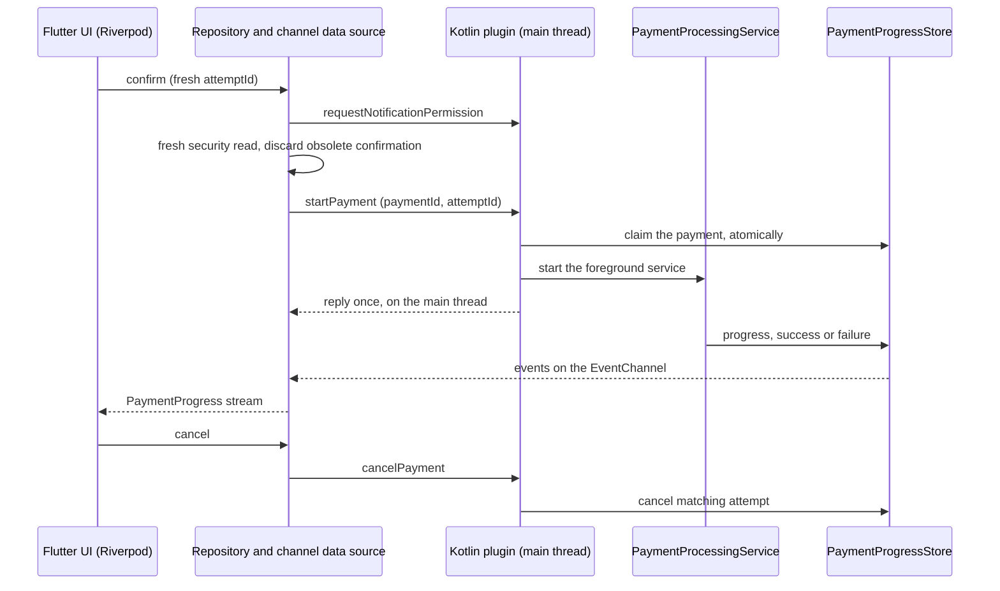

# Secure Payment Portal

A multi-tenant **payment confirmation module** built from one Flutter codebase. Two brands ship from it, each its own
Android app:

| | Retail Shop (`retail`) | Utility Pay (`utility`) |
|---|---|---|
| Look | orange and gold, rounded, fluid motion | navy and slate, sharp, dense, crisp |
| Payment page | bill summary and a **Promo Banner** | bill summary and a **Bill Breakdown** list |


<!-- A GIF of switching brand (from the demo recording) goes here: docs/images/brand-switch.gif -->
_A GIF of the brand switch will be added here from the demo recording._

What is in it:

- **White-label engine.** A brand is a folder of configuration, a registry line, a manifest entry and an icon folder.
  No feature code changes to add one ([how](#add-a-brand)).
- **Android native (Kotlin).** Root and screen-recording detection, `FLAG_SECURE` while the payment page is visible, and a
  foreground service with a live progress notification that carries the payment out
  ([details](#native-android-features)).
- **A security scan animation** drawn by a `CustomPainter`, math-driven and exactly periodic, styled from each brand's
  tokens, with no widget rebuilt per frame ([details](#the-security-scan)).
- **Clean Architecture** (`presentation → domain ← data`), Riverpod 3, sealed `Result`/`Failure`, one rule per layer,
  enforced by tests ([architecture](#architecture)).
- **Backend: none.** Payment APIs are simulated behind the interfaces a real backend would use.

Written with AI coding agents (Claude Code, and OpenAI Codex as an independent reviewer), under written rules, with every milestone planned and approved first:
[AI Insight Report](docs/ai/AI_INSIGHT_REPORT.md) and [Prompt Log](docs/ai/PROMPT_LOG.md).

## Run it

### Requirements

- Flutter 3.41.x (Dart 3.11.5, see `environment.sdk` in `pubspec.yaml`). CI pins 3.41.9.
- Android SDK 36.
- **JDK 21** for Android builds: it is what CI and the author's machine use. The code targets Java 17 bytecode, but no
  other JDK was tried. JDK 25 is known to fail: Gradle configuration stops with `IllegalArgumentException: 25.0.1`
  because the Kotlin Gradle plugin (2.2.20) cannot parse that version.
  - Point Flutter at a JDK 21 once: `flutter config --jdk-dir="<path to JDK 21>"`, then check with `flutter doctor -v`.
  - Raw Gradle calls (`./gradlew …`) do not read that setting. Prefix them for that command:
    `JAVA_HOME="<path to JDK 21>" ./gradlew …`.
- `jq` for `tool/build_release_apks.sh`; ImageMagick only to regenerate launcher icons.

### Flavors

One Android flavor per brand, named after the brand id. `--flavor` is required: a plain `flutter run` or
`flutter build apk` fails, because no flavor-less APK exists.

```bash
flutter run --flavor retail                  # or utility; add --profile to keep the demo panel and run fast
flutter build apk --debug --flavor retail
flutter build apk --release --flavor utility
tool/build_release_apks.sh                   # every brand's release APK into dist/, with SHA256SUMS
```

APKs land in `build/app/outputs/flutter-apk/` as `app-<flavor>-<mode>.apk`. Both brands install side by side
(`com.hypertenant.secure_payment_portal.retail` and `.utility`).

**Debug and profile builds** have the demo tools (brand switcher, demo panel, performance overlay). **Release builds do
not**, by design: they are what a user would get.

### Release signing

`flutter build apk --release --flavor <brand>` produces an APK signed with the **debug keys**. That is deliberate: the
repository holds no keystore and no secret, so anyone can build and install a release APK. These APKs are for review, not
for a store, and an APK from CI will not install over one built on another machine (different debug key). A store release
needs a real signing config (a keystore and its passwords, supplied from outside the repository, for example from CI
secrets), which is not part of this project.

## Architecture



- **The dependency rule** is `presentation → domain ← data`. Domain is pure Dart (no Flutter, no channels, no JSON). Data
  never leaks DTOs or `PlatformException` upward: it maps them to typed `Failure`s. `di/` is the only place in a feature
  that sees both data and domain.
- **`test/architecture/layering_test.dart`** reads the sources and fails on a layer importing what it must not, a brand
  check outside the registry, a `print`, a fake used outside its seams, and more. The rest of the rules are lints and
  the review checklist.
- **State** is Riverpod 3 without codegen: one `Notifier` per screen or flow, side effects only in methods (never in
  `build()`), `ref.mounted` checked after every `await`, retry off at the root.
- **Errors** are values. `Result<T>` is `Success` or `Err(Failure)`; each feature has its own sealed `Failure` family, so a
  `switch` is exhaustive.

The payment flow is one state machine in one notifier:



And a payment crosses the bridge like this:



The wire contract (channel names, payload shapes, error codes, threading and lifecycle rules) is in
[docs/platform_channels.md](docs/platform_channels.md); Dart and Kotlin keep the constants in step, and a test compares
the two files.

## Multi-tenancy

A brand is made of:

```
lib/brands/<id>/<id>_brand.dart   a const BrandConfig: tokens (colors, shape, density, motion) and the payment layout
android/brands.json               one entry: id, displayName, applicationIdSuffix
android/app/src/<id>/res/         the launcher icon, in the brand's colors
lib/app/brand/brand_registry.dart one line
```

- **Visual differences are tokens**: four `ThemeExtension`s with real `lerp`, so switching brand animates. The theme is
  derived from them by one `ThemeFactory` for every brand. ThemeExtensions plus Riverpod overrides (an `InheritedWidget`
  underneath) are this project's answer to "ThemeExtensions, InheritedWidget, or a similar scalable pattern".
- **Structural differences are data.** The Promo Banner and the Bill Breakdown are not an `if (brand == …)`: a brand lists
  section specs, and a registry keyed by spec type draws them. A feature never imports a brand and never branches on one;
  only `brand_registry.dart` reads `appFlavor`.
- **Contrast is checked per brand**: every color the components use has a row in one table (4.5:1 for text, 3:1 for UI),
  and the table runs for every registered brand.

### Add a brand

1. `lib/brands/<id>/<id>_brand.dart`, a `const BrandConfig` (copy one and change the tokens). Name a bill the backend
   knows (against the simulated backend, one in `FakeBills`; a brand may reuse one).
2. One line in `lib/app/brand/brand_registry.dart`.
3. One entry in `android/brands.json`. The flavor, its application id and its launcher label come from it; Gradle needs no edit.
4. `android/app/src/<id>/res/`: copy another brand's, set the three colors in `values/ic_launcher_colors.xml`, edit the
   glyph in `drawable/ic_launcher_foreground.xml`, run `python3 tool/make_launcher_icons.py` for the legacy PNGs.

Tests and Gradle enforce each step: the manifest must match the registry, a brand without an icon fails the build, icon
colors must equal the tokens, and every per-brand test (renders the page, contrast, tokens read, bill exists) picks the new
brand up from the registry. This was tried on a scratch third brand: those four things, every test green, a built APK, and
nothing changed under `lib/features` or `lib/core`.

## Native Android features

All Kotlin lives behind small ports (so it is unit-tested on the JVM) and `MainActivity` only wires plugins. Every channel
call replies exactly once, on the main thread.

- **Root detection.** Six independent checks run concurrently: `su` binary, Magisk artifacts, root-manager packages,
  `which su`, test-keys and a debuggable build. The result is tri-state (`detected`, `notDetected`, `unknown`); `unknown`
  only when every check was inconclusive.
- **Screen recording.** From Android 15 (API 35) `WindowManager.addScreenRecordingCallback` reports it as a stream. Below
  35 the state is `unknown` (the policy allows it), never "not recording".
- **Window protection.** `FLAG_SECURE` is reference counted, re-applied when the Activity is recreated, and reported back
  from the window itself. It also hides the Recents thumbnail. It is real in every mode, simulated or not, so a
  screenshot, a screen recording or `adb screencap` of the payment page is black.
- **Payment foreground service.** A `shortService` foreground service (declared alone, as the platform requires) runs the
  simulated payment (20 steps of 400 ms) with a progress notification: generic text, private on the lock screen, throttled
  to two updates a second, with a **Cancel** action handled by a non-exported broadcast receiver. `START_NOT_STICKY`, one
  payment at a time, `onTimeout` handled, `ServiceCompat` for the foreground type and the stop. Denying the notification
  permission (Android 13+) never stops a payment.
- **State** that the service, the plugin and a cancel from the notification all touch lives in one process-wide store with
  atomic transitions, so the first of a cancel and a finish wins and a refused start gives its claim back. Every execution has its own attempt id (wire schema 2), so a late event, a stale cancel or a duplicate delivery from an earlier attempt cannot touch a retry.

### Security policy

Whether a payment may be confirmed is decided by `SecurityPolicy` (pure Dart, `lib/features/security/domain/`):

| Device state | Decision |
|---|---|
| a strong root signal (su binary, Magisk, root manager) | blocked |
| only weak root signals (test keys, debuggable build) | allowed |
| root could not be verified | blocked (fail-closed) |
| screen recording in progress | blocked; lifts when the recording ends |
| screen recording state unknown (below Android 15) | allowed |
| the window could not be protected | blocked, recoverable ("Check again") |

Weak signals are common on emulators and developer builds, so they do not block on their own. Each of these choices is a
constructor flag on the policy.

## The security scan

While the device is being checked the security card shows a radar: a sweep that goes round once per period, with three
pulses staggered a third of a period apart. It is a `CustomPainter` (`lib/core/design_system/scan/`), and all of its maths
is a function of one number, the phase of the animation, documented in `scan_math.dart` (formulas, period, why it repeats
without a seam).

- **Each brand gets its own scan from its tokens, with no brand check.** `ScanStyle` reads the glow (`scanGlow`), the
  rings (`outlineSubtle`) and the pulse easing (`motion.standard`), and sets the period to four times `motion.slow`, held
  between 1.6 s and 3 s: Retail turns in 2.4 s with soft pulses, Utility in 1.6 s with quick ones.
- **No rebuilds, one repaint layer.** A still backdrop and the moving part sit in two `RepaintBoundary`s; the moving painter
  listens to the animation itself. `paint()` allocates nothing, and the ticker exists only while the scan is on screen.
  With reduced motion the scan shows a still pose and nothing animates.
- **The verdict waits for the sweep to go all the way round.** A real device check takes a fraction of a second, which
  would make the scan a flash that a release build never really shows. The flow therefore holds the verdict until the end
  of a revolution: `max(how long the check took, one period)`, rounded up to the end of the revolution it finished in. Pay
  is enabled 2.4 s after the check starts on Retail and 1.6 s on Utility, on any device that answers quickly. The wait is
  the brand's own period, so there is no number to configure. It is not applied with reduced motion (nothing sweeps), not
  to the second check made when Pay is pressed, and not in tests.

### Performance

Measured by `integration_test/scan_performance_test.dart` (`flutter drive --profile --no-dds`), per brand, median of three
8 s runs, on a **Pixel_9 emulator** (profile build, 60 Hz). A phone run is pending in [docs/MANUAL_QA.md](docs/MANUAL_QA.md).

| Variant | UI thread, avg (ms) | New-gen GCs in 8 s | Frames per second |
|---|---|---|---|
| the scan in the app, Retail | 1.15 | 2 | 60.3 |
| the scan in the app, Utility | 1.18 | 2 | 59.1 |
| a layer that draws one dot (the least possible) | 0.92 to 1.08 | 2 | 59.9 |
| Material's own spinner | 1.40 | 6 | 59.4 to 59.9 |

The scan costs about 0.1 to 0.2 ms more than the least an animating layer can cost, less than Material's spinner, and
allocates as little as the floor. **Raster time on the emulator is not informative** (the one-dot layer also takes 13 to
16 ms there, the emulator's swap path), so it is left out of the table; it and the whole method are in
[the performance appendix](docs/ai/appendix/performance.md).

```bash
flutter drive --profile --no-dds --flavor retail -d <device id> \
  --driver=test_driver/integration_test.dart \
  --target=integration_test/scan_performance_test.dart \
  --dart-define=DEVICE_NAME="<what to call the device>"      # about 6 minutes; writes build/scan_performance/summary.md
```

## Demo scenarios (debug and profile builds)

Whenever a device or backend is hard to put in a given state, every source with a platform side can run on a **simulation**.
The tune icon in the app bar opens a panel where, per source (device security, payment processing), you pick *Real* or
*Simulated* and, for a simulated one, play a situation:

- a clean, rooted, weakly-rooted or unverifiable device;
- a screen recording that starts and stops while the screen is open;
- how long the device check takes (1.5 s, 5 s, 15 s), to hold the scan on screen;
- a payment that succeeds, is declined, or fails while processing;
- a bill backend that goes offline (simulated by design: there is no backend).

A **SIMULATED** badge sits in the app bar while any source is simulated, in every build mode. The simulation replaces the
security *readings* only, never the window: `FLAG_SECURE` is applied through the real source in every mode. The panel's
*Display* section turns on Flutter's performance overlay, and the app bar has the brand switcher. In Real mode the panel
shows a read-only **Device reports** block (the root signals that fired, whether a recording is detected, whether the
window is protected).

## Tests and CI

```bash
dart format --set-exit-if-changed lib test integration_test test_driver
flutter analyze                                  # zero issues
flutter test                                     # 855 Dart tests
(cd android && JAVA_HOME="<path to JDK 21>" ./gradlew testDebugUnitTest)   # 220 Kotlin JVM tests
flutter build apk --debug --flavor retail && flutter build apk --debug --flavor utility
```

- **Dart.** Domain and policy; data sources against the same contract suites as their fakes (the channel sources run
  unchanged against a Dart stand-in for the native side); notifiers through `ProviderContainer`; widgets; every registered
  brand; the layering rules; the documentation links.
- **Kotlin.** The ports, root checks, reply-once and threading, the secure window count, the payment store, session,
  notification throttle and handlers, and a guard over the manifest (permissions, one exported component, a
  `shortService`-only service, backups off).
- **Mutation checks.** New logic was checked by breaking the code and seeing a test fail; the survivors are listed in the
  [Prompt Log](docs/ai/PROMPT_LOG.md).
- **CI** (`.github/workflows/ci.yml`) runs the format check, analysis and both test suites on every push to `main` and every
  pull request, then builds a release APK per brand (the list comes from `android/brands.json`) and uploads it as an
  artifact. Flutter 3.41.9, Temurin 21, every action pinned to a commit SHA.
- **On a device.** What an emulator cannot show is a checklist for one run on a phone: [docs/MANUAL_QA.md](docs/MANUAL_QA.md).
  [docs/DEMO_SCRIPT.md](docs/DEMO_SCRIPT.md) is the shot list for the demo video, which is recorded from the emulator window
  with macOS screen capture, because `FLAG_SECURE` blacks out any capture made inside Android.

## Known limitations

- **Android only.** iOS compiles (a simulator build is checked) but has no native side: root detection resolves as
  `unknown`, and the fail-closed policy blocks payment there by design. In a debug build, switch Device security to
  *Simulated* to get a working screen on iOS or desktop.
- **Release APKs are debug-signed** (see [Release signing](#release-signing)).
- **Root detection is heuristic** and can be bypassed (renamed packages, hiding tools); Play Integrity is out of scope.
- **Screen recording detection needs Android 15.** Below it the state is `unknown` and allowed. Whether the callback fires
  for a window that is itself `FLAG_SECURE` is unverified (`M4-5` in the manual checklist).
- **Payments are simulated.** The native processing always succeeds; declines and failures are simulated scenarios. A killed
  process loses an in-flight payment (the state is in memory, the service is not sticky): a real backend would need an
  idempotency key and reconciliation, described in [the appendix](docs/ai/appendix/payments-in-production.md).
  `shortService` stops after about three minutes, fine for this simulation and not for a long real call.
- **The verdict dwell is a product cost:** Pay is enabled 1.6 to 2.4 s after the check starts, on every visit.
- **Frame timing was measured on an emulator.** Nothing is claimed for 90 or 120 Hz or a real GPU until the phone run.
- **Manual QA is pending.** The wire contract is marked draft until the checklist in `docs/MANUAL_QA.md` has been run on a
  physical phone; anything that depends on it says so.
- **Money and dates are not locale-aware.** Amounts are integer minor units in a `Money` value object, never `double`, and
  format as `$1,234.50`; receipts show UTC time. Neither uses `intl`, so grouping, symbol position and date order are fixed.
- **Light theme only** (tokens are brightness-agnostic, so a dark set can be added).

## Documents

| | |
|---|---|
| [AI Insight Report](docs/ai/AI_INSIGHT_REPORT.md) | multi-tenant structure, how AI accelerated the work, one sub-optimal AI solution and its correction, with appendices |
| [Prompt Log](docs/ai/PROMPT_LOG.md) | highlights, then every significant interaction with its corrections |
| [Platform channels](docs/platform_channels.md) | the Dart ⇄ Kotlin wire contract, with what was verified on a device |
| [Manual QA](docs/MANUAL_QA.md) | what needs a person and a phone |
| [Demo script](docs/DEMO_SCRIPT.md) | the shot list for the demo video |
| [AGENTS.md](AGENTS.md) and [.agents/rules](.agents/rules) | the rules the AI agent worked under |
