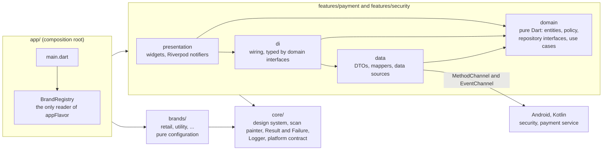
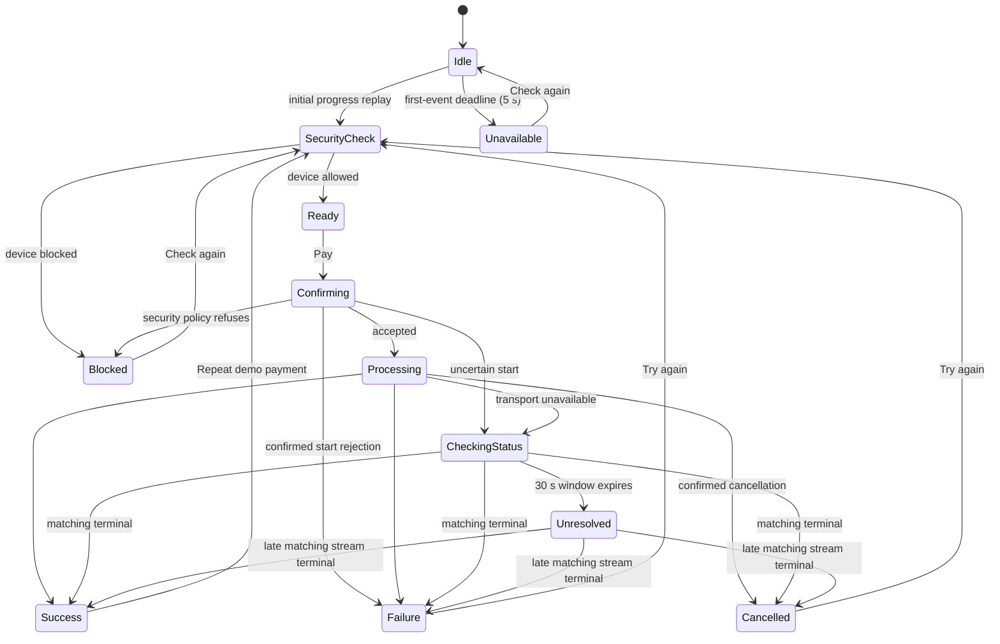
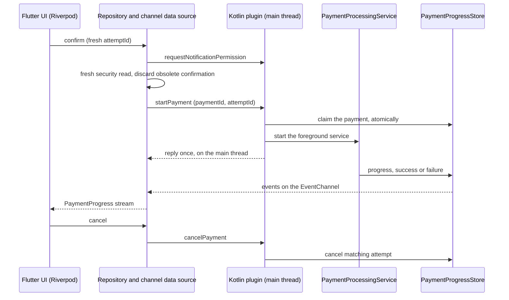

# Appendix B: Brand guide and scaling path

Part of the [AI Insight Report](../AI_INSIGHT_REPORT.md). The [architecture](#architecture) and
[brand guide](#multi-tenancy) describe the implementation; the options below are future proposals.

## Future scaling options


The design targets a handful of brands: two today, comfortably up to about ten. Past that, two changes would pay off. They are described here on purpose and are **not implemented**, because building them now would add machinery that two brands do not need.

**10+ brands: tokens as data.** Brand tokens move out of Dart into JSON design tokens exported from Figma. They are checked against a JSON schema and turned into `BrandTokens` by code generation, so a new brand is data plus assets rather than a hand-written `const BrandConfig`. The current code already allows this. `BrandTokens` is a plain, value-equal bundle of four small extensions. `ThemeFactory` is a pure function of it. Nothing outside `BrandRegistry` knows how a brand is produced, so a generator would emit the same `BrandConfig` values the registry holds today. The contrast table and the all-brands tests already run over every registered brand. They are the safety net that keeps a token change made by a non-developer from shipping an unreadable brand. A small generator script needs no new package. A package such as `build_runner` would need approval first, under the rules in `AGENTS.md`.

**Separate teams or release cycles: a monorepo.** Pub workspaces with shared `core` and feature packages, and a thin app shell per brand (flavor, `BrandConfig`, assets). This is cheap here because the dependency rule is already one-directional: `core` imports nothing, features import `core` (and another feature's public domain barrel), brands import `core`, and only `app` imports `brands`. Features never import `brands` or `app`, so each folder can become a package without untangling anything.

**Out of scope: runtime multi-tenancy.** A tenant chosen at login, with the theme served from a backend, would replace compile-time flavor resolution with a runtime lookup and remote tokens. That brings offline behaviour, caching and the trust placed in remote configuration, none of which this module addresses.

## Architecture



- **The dependency rule** is `presentation → domain ← data`. Domain is pure Dart (no Flutter, no channels, no JSON). Data
  never leaks DTOs or `PlatformException` upward: it maps them to typed `Failure`s. `di/` is the only place in a feature
  that sees both data and domain.
- **`test/architecture/layering_test.dart`** reads the sources and fails on a layer importing what it must not, a brand
  check outside the registry, a `print`, a fake used outside its seams, and more. The rest of the rules are lints and
  the review checklist.
- **State** is Riverpod 3 without codegen: one `Notifier` per screen or flow, side effects only in methods (never in
  `build()`), `ref.mounted` checked after every `await`, retry off at the root.
- **Errors** are values. `Result<T>` is `Success` or `Err(Failure)`; each feature has its own sealed `Failure` family, so a
  `switch` is exhaustive.

The payment flow is one state machine in one notifier:



An uncertain outcome retains its attempt ID and Cancel. Snapshot queries run immediately and with backoff alongside stream
updates; window expiry changes the guidance and keeps payment retry unavailable. Idle snapshots never prove rejection.
The [channel contract](../../platform_channels.md#uncertain-payment-outcomes-and-reconciliation) records the classification table.

And a payment crosses the bridge like this:



The wire contract (channel names, payload shapes, error codes, threading and lifecycle rules) is in
[docs/platform_channels.md](../../platform_channels.md); Dart and Kotlin keep the constants in step, and a test compares
the two files.

## Multi-tenancy

A brand is made of:

```
lib/brands/<id>/<id>_brand.dart   a const BrandConfig: tokens (colors, shape, density, motion) and the payment layout
android/brands.json               one entry: id, displayName, applicationIdSuffix
android/app/src/<id>/res/         the launcher icon, in the brand's colors
lib/app/brand/brand_registry.dart one line
```

- **Visual differences are tokens**: four `ThemeExtension`s with real `lerp`, so switching brand animates. The theme is
  derived from them by one `ThemeFactory` for every brand. ThemeExtensions plus Riverpod overrides (an `InheritedWidget`
  underneath) are this project's answer to "ThemeExtensions, InheritedWidget, or a similar scalable pattern".
- **Structural differences are data.** The Promo Banner and the Bill Breakdown are not an `if (brand == …)`: a brand lists
  section specs, and a registry keyed by spec type draws them. A feature never imports a brand and never branches on one;
  only `brand_registry.dart` reads `appFlavor`.
- **Contrast is checked per brand**: every color the components use has a row in one table (4.5:1 for text, 3:1 for UI),
  and the table runs for every registered brand.

### Add a brand

1. Add `lib/brands/<id>/<id>_brand.dart` with a `const BrandConfig` and a `const BrandRegistration`. Visual configuration
   lives in BrandConfig; bill selection is `BrandRegistration.demoPaymentId`. Declare that brand's `DemoBill` data beside it
   and include it in `demoBills`. The simulated backend receives the catalog from registrations through root DI.
2. Import the registration in `lib/app/brand/brand_registry.dart` and add a const list entry:
   `if (!kReleaseMode || appFlavor == '<id>') <id>Registration`. Debug/profile retain every registration; release retains its flavor.
3. Add an entry to `android/brands.json`. The flavor, application ID suffix and launcher label come from it; Gradle needs no edit.
4. Add `android/app/src/<id>/res/`: copy another brand's resources, set the three colors in `values/ic_launcher_colors.xml`, edit
   the glyph in `drawable/ic_launcher_foreground.xml`, and run `python3 tool/make_launcher_icons.py` for the legacy PNGs.
5. Run the checks and release isolation checker against each binary. Adding a brand or demo bill requires no feature edits.

Tests and Gradle enforce each step: the manifest must match the registry, a brand without an icon fails the build, icon
colors must equal the tokens, and every per-brand test (renders the page, contrast, tokens read, bill exists) picks the new
brand up from the registry. This was tried on a scratch third brand: those four things, every test green, a built APK, and
nothing changed under `lib/features` or `lib/core`.
